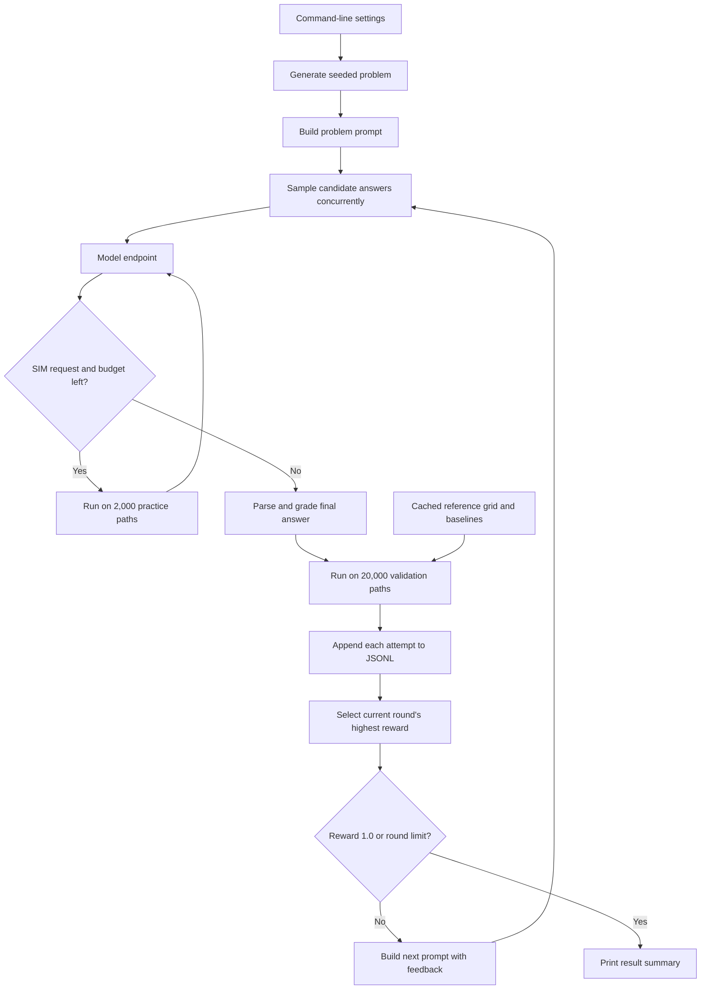

# Level 5 code walkthrough: how the hedging agent works

This guide explains the current level-5-only implementation, from a command-line invocation to model proposals, simulated trades, rewards, and logs. Start with [README.md](README.md) for installation. This document describes executable behavior; the two-agent adversarial system discussed at the end is a future extension.

## 1. What problem is being solved?

You have sold one European call option and received a premium. You hold shares to offset changes in the option's value. Rebalancing the shares reduces hedge error but costs money each time you trade.

The model chooses **when to rebalance**, not the option's price or the market path. It tries to minimize:

```text
J = mean(total transaction fees across paths)
    + lambda × standard deviation(terminal profit and loss across paths)
```

A smaller J is better. `lambda`, named `lam` in code, controls the weight given to risk. The risk statistic is the dispersion of terminal P&L; it is not maximum loss, expected shortfall, or a separate penalty on mean loss.

There are three tasks:

| Task | Model chooses | Required final answer example |
|---|---|---|
| 5.1 | An integer rebalancing interval, 1–63 steps | `policy: interval=5` |
| 5.2 | A constant no-trade band, 0–0.5 shares | `policy: band=0.08` |
| 5.3 | A formula for a state-dependent no-trade band | `band(gamma,S,tau) = 1.4*(c*S*gamma**2)**(1/3)` |

These examples show syntax, not universally optimal policies. A band is measured in shares of delta, not dollars or percent of stock price.

The code still uses Black–Scholes for the initial premium and target delta/gamma, and constant-volatility geometric Brownian motion for stock paths. The practical friction is discrete trading with proportional fees. Removing level 3 removed the formula-pricing task; it did not replace the underlying market model.

## 2. Architecture and file map



| File | Responsibility | Functions worth reading first |
|---|---|---|
| [agent.py](agent.py) | Model requests and iterative search | `main`, `solve`, `ask_round`, `one_attempt`, `next_prompt` |
| [level5_hedge.py](level5_hedge.py) | Problem generation, policy parsing, SIM tool, grading | `make`, `prompt_of`, `parse_policy`, `sim`, `check`, `reference` |
| [hedgesim.py](hedgesim.py) | Stock paths, hedge accounting and numerical reference search | `PathSet.__init__`, `PathSet.run`, `PathSet.band_from`, `best_policy` |
| [hedge_core.py](hedge_core.py) | Benchmark call premium and restricted expression evaluation | `bs_call`, `last_line`, `compile_expr` |
| [run_all.sh](run_all.sh) | Test, offline, live and comparison commands | `selftest`, `need_model`, mode dispatch |
| [report.py](report.py) | Summarize attempts by tag, problem and seed | `load`, `main` |
| [test_hedge_core.py](test_hedge_core.py) | Numerical, parser and scoring regression tests | `HedgeCoreTests` |
| [test_plumbing.py](test_plumbing.py) | Scripted end-to-end SIM exchange | `run`, `main` |
| [make_figures.py](make_figures.py) | Hedge trade-off charts and reference numbers | Script body |
| [diagnostics/simulator_audit.py](diagnostics/simulator_audit.py) | Reference search without a model | Script body |

The dependency chain is `agent → level5_hedge → hedgesim → hedge_core`; `level5_hedge` also imports the parser directly from `hedge_core`. No active code depends on level 3.

The simulator and checker run on CPU with NumPy/SciPy. A remote Trainium instance can host the language-model endpoint, but no Trainium-specific operation is required by the local simulator.

## 3. Follow one execution through the code

Assume commands are run from this directory:

```bash
export OPT_BASE_URL=http://localhost:8000/v1
export OPT_MODEL=Qwen/Qwen3-8B
../.venv/bin/python agent.py --sub 2 --seed 0 --samples 4 --rounds 4
```

### Step A: parse settings in `agent.main()`

Only `--level 5` is accepted, and 5 is the default. `--sub 2` selects the constant-band task. With no subproblem, or with `--all`, the program runs 5.1, 5.2 and 5.3 sequentially.

The agent requires a model endpoint unless `--offline` is enabled. It opens the selected JSONL log in append mode, constructs each problem, and calls `solve()`.

### Step B: create a reproducible problem in `make()`

The problem generator uses `random.Random(7000 + seed*100 + sub)`. Its choices are:

| Parameter | Possible generated values |
|---|---|
| Initial stock `S0`, strike `K` | Both 100 |
| Maturity `T` | 0.5 or 1 year |
| Proportional fee `c` | 0.005, 0.0075 or 0.01 |
| Risk weight `lam` | 1 or 2 |
| Volatility `sigma` | 0.2 or 0.3 |
| Interest rate `r` | 0 or 0.02 |
| Decision steps | `round(252*T)`, so 126 or 252 |

The returned dictionary contains `name`, `level`, `sub`, `seed`, `prm`, `family` and `hint`. It is passed through the agent and checker. For example, `family` is `band` for subproblem 2.

`--seed` changes this problem configuration. It does **not** set a random seed on the live model server, and it does not change the fixed practice/validation path seed constants.

### Step C: build the prompt in `prompt_of()`

The prompt explains the contract, fees, objective and allowed policy format. Task 5.3 also explains the available formula variables. `--hint 1` adds a general state-dependent-band hint; `--hint 2` adds a cube-root-scaling hint. Hints affect only task 5.3.

### Step D: generate a round in `ask_round()`

A thread pool calls `one_attempt()` once per sample. All samples receive the same round prompt and use the same model. They are concurrent candidate proposals, not distinct agents with different roles.

`ask_once()` sends a POST to `<base>/chat/completions` with:

- The selected model and a single user-message string.
- Temperature 0.6 and top-p 0.95.
- Default maximum output length of 1,500 tokens.
- `chat_template_kwargs.enable_thinking`, false unless `--think` is supplied.
- A 900-second HTTP timeout and HTTPS verification enabled.

The endpoint must support the request fields, including the template-specific thinking option. There is no automatic retry loop. A non-200 response stops the run; empty response content becomes an empty answer and is subsequently rejected by the checker.

### Step E: handle optional simulator requests in `one_attempt()`

A model may return:

```text
SIM: band=0.05
SIM: band=0.12
```

`requests_in()` collects at most four `SIM:` lines. Each goes through `sim()`, which parses it as a policy and evaluates it on the practice paths. The response gives J, mean fees, P&L risk and average trade count.

The agent appends the model reply and simulator results to its growing text prompt, then asks the model for a final answer. It does not use a native JSON/function-calling tool protocol; tool interaction is implemented with text markers and regular expressions.

By default, `--tool-steps 1` permits one such exchange. That means at most two model calls per sample: the initial request and the reply after tool results. With the default four samples and four rounds, the upper bound is 32 model calls and 64 individual SIM evaluations per subproblem. Early success or replies without tools reduce that count. Reference-grid evaluations are additional work and are not counted as SIM calls.

At the tool limit, the latest model reply is returned without executing more requests. If it contains only `SIM:` requests and no valid final policy, grading fails. `--no-tools` suppresses both the tool instructions and tool execution.

### Step F: grade all candidates in `solve()`

After all sampling futures return, candidates are graded sequentially by `check()`. Each gets a numerical reward and feedback. `solve()` writes every candidate to the log, picks the highest reward in the current round, and either stops or constructs another prompt.

The loop stops when a candidate scores exactly 1.0, or when the round budget is exhausted. “SOLVED” means that the five benchmark criteria passed, not that a global or real-market optimum was proved.

If two candidates have the same reward, Python's `max()` retains the first encountered. The continuous J value is not used as a tie-breaker. `best_ever` stores only the highest scalar reward; it does not preserve an earlier winning policy for future prompts.

## 4. How the simulator builds the market

`PathSet(prm, paths, seed)` precomputes arrays that all candidate policies can reuse. Let P be the number of paths and n the number of decision steps. An odd requested path count is rounded down to an even number.

The stock transition implemented by `PathSet.__init__()` is:

```text
Δt = T / n
S[i+1] = S[i] × exp((r - sigma²/2) × Δt + sigma × sqrt(Δt) × z[i])
```

Half the normal draws are sampled; the other half are their negatives. These antithetic pairs are intended to reduce simulation variance. Paired paths are not independent observations, which matters if confidence intervals are added later.

| Array | Shape | Meaning |
|---|---|---|
| `S` | `(P, n+1)` | Stock price at start, each step and maturity |
| `tau` | `(n,)` | Time remaining before maturity at each decision |
| `delta` | `(P, n)` | Benchmark target share holding |
| `gamma` | `(P, n)` | Sensitivity of benchmark delta to stock price |

For each decision point, the code computes:

```text
d1 = [log(S/K) + (r + sigma²/2) × tau] / [sigma × sqrt(tau)]
delta = N(d1)
gamma = exp(-d1²/2) / [sqrt(2*pi) × S × sigma × sqrt(tau)]
```

`N` is SciPy's standard-normal CDF. The initial premium comes from `hedge_core.bs_call()`. The decision arrays exclude maturity, so `tau` remains positive when computing Greeks.

There are currently no jumps, stochastic volatility, dividends, bid/ask spreads, market impact, liquidity limits or historical market inputs. Proportional fees are the only execution friction.

## 5. How `PathSet.run()` executes a hedge

Each path begins with zero shares and a cash balance equal to the premium. At time zero the simulator always buys the benchmark delta, regardless of interval or band, and charges a fee.

At each later decision time:

1. Accrue cash at `exp(r*Δt)`, including steps where no trade occurs.
2. If the step is not a multiple of the chosen interval, skip trading.
3. Otherwise compute `diff = target_delta - current_holding`.
4. Trade the entire difference only when `abs(diff) > band`.
5. Charge `fee = c * stock_price * abs(trade)`.
6. Update `cash -= trade*stock_price + fee`, holdings, accumulated fees and trade count.

The strict `>` matters: a gap equal to the band does not trigger a trade. Once triggered, a trade goes all the way to the target delta, not merely to the edge of the band.

For example, with 0.40 shares held and a target delta of 0.46, a band of 0.08 causes no trade. If the target moves to 0.51, the gap is 0.11 and the simulator buys 0.11 shares. At stock price 100 and fee rate 0.005, that trade costs `0.005*100*0.11 = 0.055` in fees.

At maturity the cash accrues for the last interval. Holdings are adjusted to one share if `S_T > K`, otherwise zero, and that adjustment incurs a fee. The final P&L is:

```text
P&L = remaining_cash + final_holding*S_T - max(S_T-K, 0)
```

`_summary()` returns:

| Field | Meaning |
|---|---|
| `J` | Mean fees plus `lam*risk` |
| `cost` | Mean accumulated nominal fees; this total is not compounded |
| `risk` | `pnl.std()` with NumPy's default population normalization |
| `trades` | Average count of nonzero trades, including setup and settlement |
| `pnl_mean` | Mean terminal P&L, reported but not a separate objective term |

Fees already reduce cash and therefore affect the P&L distribution. The objective additionally includes mean fees explicitly. Negative cash accrues at the same rate as positive cash; there is no distinct borrowing spread.

`unhedged()` is a separate baseline: receive the premium, accrue it, and pay the option payoff without stock trades or transaction fees. It differs from choosing an extremely wide band, because band policies still set up the initial delta and settle holdings at maturity.

## 6. State-dependent formulas and their evaluator

For task 5.3, `parse_policy()` extracts the final matching band expression and calls `compile_expr()` in `hedge_core.py`.

Allowed inputs are `gamma`, `S`, `tau`, `c`, `lam`, `sigma`, `r`, `T` and `pi`. Allowed operations are `+`, `-`, `*`, `/`, `**`, unary signs, and `exp`, `log`, `sqrt`, `abs`, `minimum`, `maximum`.

The evaluator parses an abstract syntax tree, validates each node, and recursively applies known numerical operators. It does not call Python `eval()` or execute model-generated Python. Attributes, indexing, imports, strings, lists, lambdas and arbitrary function calls are rejected. Formulas are limited to 600 characters and 150 AST nodes.

`PathSet.band_from()` evaluates the formula over the path arrays, broadcasts a scalar result when needed, rejects invalid shapes or nonfinite values, and clips valid output to `[0,1]`. Thus a constant expression is valid, negative finite output becomes zero, and output above one becomes one. By contrast, tasks 5.1 and 5.2 reject parameters outside their stated ranges instead of clipping them.

Syntax validity does not imply numerical validity: `log(-1)` has allowed syntax, but its nonfinite output is rejected during simulation.

## 7. Practice paths, validation paths and the reference solver

| Use | Paths | Seed | Code |
|---|---:|---:|---|
| Model's SIM tool | 2,000 | 101 | `train_set()` |
| Checker and reference grid | 20,000 | 9001 | `test_set()` |

The function names retain “train” and “test,” but no model training occurs. The checker paths are validation data because feedback from them repeatedly influences future proposals. The implementation does not automatically reserve a third, untouched final test set.

`reference()` calls `best_policy()` and caches its result with the problem parameters and policy family. Path sets are cached separately by parameters and purpose. Caches exist only within the process; they are not persisted between commands.

| Family | Reference candidates |
|---|---|
| `interval` | Integers 1–63, filtered to intervals smaller than the number of steps |
| `band` | 101 constants from 0 through 0.50, step 0.005 |
| `formula` | Those 101 constants plus 80 coefficients from 0.1 through 8.0, step 0.1 |

The structured formula family is `clip(kappa*(c*S*gamma**2)**(1/3), 0, 1)`. The cube-root base is cached once per path set and reused across coefficients. These reference candidates are not all possible formulas.

The first checker call is relatively expensive because it builds the reference. Subsequent calls reuse it. Full per-policy simulation results are not generally cached, so duplicate candidate answers still incur simulation work.

The minimum is exact only within the enumerated candidates on those frozen paths, subject to floating-point arithmetic. A model can discover a policy outside that grid with a lower J; the reference is not a universal lower bound.

## 8. Reward and feedback

`check()` parses the answer, evaluates it on validation paths, and compares J with the cached baselines and reference. Every passing condition contributes 0.2:

| Part in `parts` | Condition |
|---|---|
| `valid` | Policy parsed and evaluated successfully |
| `beats_unhedged` | J is below the unhedged baseline |
| `beats_naive` | J is below the daily full-delta hedge by more than `1e-12` |
| `within_loose` | J is at most 1.10 times reference J; 1.05 for task 5.3 |
| `within_tight` | J is at most 1.03 times reference J; 1.01 for task 5.3 |

For example, if reference J were 4.0 and a valid task-5.3 policy scored 4.12 while beating both baselines, it would receive 0.8: within 5%, but not within 1%. This is an illustrative scoring example.

There is no extra reward for formula complexity. A constant formula in 5.3 receives full credit if it meets all five criteria.

When a candidate fails, feedback includes its numerical cost/risk breakdown and comparisons with the baselines. Cost and risk more than 2% above the reference policy's respective values drive suggestions such as “Trade less,” “Hedge more,” or “Both cost and risk are worse.” These are diagnostic heuristics, not gradients or proof that a particular parameter update will improve J.

`next_prompt()` supports:

| Mode | Next-round information |
|---|---|
| `full` | Base problem, current round's best policy, checker explanation |
| `score` | Base problem, current round's best policy, reward only |
| `none` | Base problem alone |

Previous tool transcripts stay within their own sample's exchange. They are not retained across rounds. The agent does not maintain a complete history of failed candidates or prevent repeats.

## 9. Offline mode and tests

`--offline` bypasses HTTP and tools. `fake_model()` selects from known good/bad policies supplied by `offline_candidates()`. Its probability of selecting a good candidate is `min(0.9, 0.15 + 0.25*round)` and its random generator is keyed by problem, seed, round and sample index.

The reference is warmed before sample threads start, avoiding duplicate offline reference construction. Because the fake model can use the known reference answer, offline success measures loop execution only. It is not evidence that an LLM learned or solved the problem.

Run the checks with:

```bash
./run_all.sh selftest
./run_all.sh offline
```

`selftest` runs seven core regression tests, simulator/scoring checks for all three tasks, and a scripted tool-loop test. Simulator checks cover zero-cost mean P&L, error scaling with step count, fee linearity, risk reduction, seed determinism and the response of the optimal band to higher fees.

The plumbing test replaces `agent.ask_once()` with a scripted response: request two SIM evaluations, receive their output, then return a known good policy. It checks that the tool output reached the next prompt and that the answer was graded and logged. It does not test a live HTTP server.

## 10. Commands and operational settings

```bash
# Inspect the problem; --answer also exposes the reference answer for debugging.
../.venv/bin/python level5_hedge.py --show 3 --answer

# All three problems with a live model; endpoint must already be available.
./run_all.sh real

# Compare removing tools, detailed feedback or the default formula hint.
./run_all.sh experiments

# Inspect logged live outcomes.
../.venv/bin/python report.py artifacts/attempts.jsonl

# Generate hedge-only charts; matplotlib is an optional dependency.
../.venv/bin/python make_figures.py
```

`real` validates the endpoint setting, runs selftests, then runs seeds 1, 2 and 3 sequentially. It does not start a model server. `experiments` uses the same three seeds but does not rerun selftests. Both commands remain in the foreground and stop on command failure.

| Setting | Default / behavior |
|---|---|
| `--samples` | 4 concurrent candidates per round |
| `--rounds` | 4 rounds maximum |
| `--tool-steps` | 1 tool exchange per candidate |
| `--max-tokens` | `OPT_MAX_TOKENS`, otherwise 1500 |
| `--base` | `OPT_BASE_URL`, falling back to `HEATROD_BASE_URL` |
| `--model` | `OPT_MODEL`, then `HEATROD_MODEL`, then `Qwen/Qwen3-8B` |
| `--log` | `attempts.jsonl` relative to the working directory |
| `--tag` | Empty by default; labels an experiment |
| `--hint` | 1; changes only 5.3 |
| `--feedback` | `full` |

The shell wrapper prefers `../.venv/bin/python`, falling back to `python3`. A `PYTHON` override should be an executable path. Direct `agent.py` calls do not create parent directories for a custom log path.

## 11. What gets logged and what the report means

Each JSONL line is one final candidate attempt, including:

```text
tag, problem, seed, round,
no_tools, feedback, hint, offline,
prompt, answer, tool_calls, reward, parts
```

The logged prompt is the round-level prompt; it does not include the appended tool instructions or complete SIM conversation. `tool_calls` counts individual SIM requests, not model requests. Round indices start at zero in the log; printed round counts in the final summary start at one.

The log currently omits continuous J, checker feedback as a separate field, full tool results, model settings, request timings and a unique run ID. Failed HTTP calls are not captured as normal graded attempts.

`report.py` excludes offline records by default and treats `(tag, problem, seed)` as the identity of a run. Repeating the same combination in the same file merges attempts. Use distinct tags or files for repetitions you want counted independently. The report prints solved counts, the middle solved-round entry (the upper middle for an even count), mean best reward and tool usage; it does not calculate confidence intervals or compare continuous costs.

## 12. Where to extend the code

| Intended change | Main location | What must remain consistent |
|---|---|---|
| Add market scenarios or volatility mismatch | `PathSet.__init__`, `make`, `prompt_of` | Separate actual dynamics from the hedge model; define premium assumptions |
| Add spreads, impact or asymmetric funding | `PathSet.run` | Cash accounting, benchmarks and simulator tests |
| Change the risk objective | `_summary`, prompt, reference and checker | All comparisons must optimize the same quantity |
| Add another policy family | Parser, `_run`, reference and prompt | Output format, admissible domain and fair reference candidates |
| Improve search memory or candidate selection | `solve`, `next_prompt` | Preserve exploration and distinguish reward from continuous J |
| Make evaluation statistically stronger | Path-set management and logging | Separate practice, feedback validation and final evaluation |
| Introduce competing agents | Agent orchestration and a new referee | Explicit roles, matched budgets and independently checked updates |

### The proposed adversarial extension is not implemented

The present code has one model proposing multiple candidates. A future proposer could try to improve the hedge while a challenger searches for a better policy or a failing scenario. A scenario adversary would change the optimization objective into a robust/minimax problem; it is not merely an extra sample from the current loop.

For certified shrinking bounds, a referee would need to maintain `L_t <= V* <= U_t` and validate every update. If a solver can always enforce a contraction factor `0 < rho < 1`, then:

```text
U_N - L_N <= rho**N * (U_0 - L_0)
```

That statement requires valid bounds and a guaranteed fallback update. Neither a coarse reward nor model agreement supplies those certificates. In particular, a reference-grid minimum is not a lower bound on all admissible hedge formulas.

For this simulator, an immediate finite-budget baseline is complete coverage of a fixed candidate set: with M candidates and at least `ceil(M/N)` distinct evaluations per round, the best candidate is known after at most N rounds. The guarantee is restricted to that finite set and frozen paths. The current code does not establish convexity or unimodality that would justify discarding a continuous interval after comparing a few policies.
